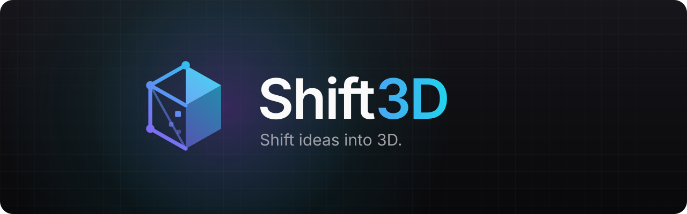

<p align="center">
  
</p>

<p align="center">
  <a href="https://github.com/vcecho100-dot/idk/releases/latest"></a>
</p>

<p align="center">
  
  
  
  
  
</p>

**Shift3D** is a native Windows app that turns text and images into textured, game-ready 3D models with AI — then lets you refine, retexture, optimize and export them straight into Godot, Unity, Unreal or Blender.

It works fully **offline** in demo mode, runs on **your own GPU** (even a 6 GB laptop card), uses **free Hugging Face Spaces** when you have no GPU or key, and plugs into **Tripo**, **Meshy** and **fal.ai** when you want the best quality.

> **Status:** in active development toward v1.0. The generation engine, offline demo, free web generation and local-GPU support are in place; the Studio editor, Library and Settings screens are being built now. See [ROADMAP.md](ROADMAP.md) for exactly what's done.

<!-- Hero GIF: docs/hero.gif (recorded from the app's own turntable export once the Studio ships) -->

## Features

- **Text, image or multi-view → 3D** with staged progress, 4-variant generation and version history.
- **Many ways to generate**
  - **Offline demo** — no account, no internet; realistic staged progress with bundled sample models.
  - **Local GPU** — your own Hunyuan3D-2 or TRELLIS server, 100% private. On **6 GB** cards Shift3D runs Hunyuan3D-2mini for the shape and colors it by projecting your image onto the mesh.
  - **Free web generation** — public Hugging Face Spaces (FLUX → Hunyuan3D-2). An optional free HF token raises your daily GPU time. Used automatically when your local server is offline.
  - **Tripo**, **Meshy**, **fal.ai** (TRELLIS, Hunyuan3D v2) with your own API keys.
- **Jobs that survive restarts** — queue several generations; they keep running while you work and resume after a restart. Results are downloaded the moment they're ready.
- **Refine, retexture, auto-rig** (idle / walk / run) where the provider supports it — and clearly disabled with the reason where it doesn't.
- **Viewer** with textured, clay, wireframe, normals, UV-checker and per-map views, six lighting presets, contact shadows, SSAO and bloom *(in progress)*.
- **Local tools** — stylize (voxel, low-poly, smooth), optimize (decimate, Draco, meshopt), transform, materials *(in progress)*.
- **Export** to GLB, glTF, OBJ, STL and USDZ with Godot / Unity / Unreal / Blender / 3D-print presets, **Send to Godot** in one click, **Open in Blender**, and turntable MP4/GIF *(in progress)*.
- **A web demo** of the offline mode that runs entirely in your browser *(GitHub Pages, coming with v1.0)*.

## Security & privacy

- **No telemetry, no analytics.** Shift3D never phones home.
- **API keys live in Windows Credential Manager** — never in files, logs, `localStorage`, or the web view.
- **All network traffic goes through Rust**, restricted to a hardcoded allowlist of provider domains plus the local server *you* configure. Downloads and redirects are checked against the same list.
- **Least-privilege web view:** no file-system, shell, HTTP or SQL access. Models are served to the viewer by ID over a custom `s3d://` protocol; dropped and opened files become single-use tokens; every dialog runs natively in Rust.
- **Strict CSP** with no remote scripts, fonts or CDNs. Everything — fonts, decoders, sample models — is bundled.
- **Every file is validated:** size limits, GLB magic/structure checks, no path traversal (`.gltf` sidecars must sit next to the file), and zip-bomb protection for `.shift3d` projects (entry, size and compression-ratio caps on real decompressed bytes).
- **Deleting never destroys data** — projects and versions go to the Recycle Bin.

See [SECURITY.md](SECURITY.md) to report a vulnerability.

## Providers

| Provider | Needs | Text | Image | Multi-view | Refine | Retexture | Rig |
| --- | --- | :-: | :-: | :-: | :-: | :-: | :-: |
| Offline demo | nothing | ✓ | ✓ | ✓ | ✓ | ✓ | ✓* |
| Hugging Face (free) | nothing (token optional) | ✓ | ✓ | – | ✓ | – | – |
| Local GPU | your Hunyuan3D / TRELLIS server | ✓† | ✓ | – | ✓ | – | – |
| Tripo | API key (`tsk_…`) | ✓ | ✓ | ✓ | ✓ | ✓ | ✓ |
| Meshy | API key (`msy_…`) | ✓ | ✓ | ✓ | ✓ | ✓ | ✓ (humanoids) |
| fal.ai | API key | ✓ | ✓ | ✓ | ✓ | – | – |

\* The demo rigs its humanoid and quadruped samples. † Local servers take images; text prompts get a reference image from the free FLUX Space first.

### Running locally on a 6 GB GPU (e.g. RTX 3060 Laptop)

1. Install [Hunyuan3D-2](https://github.com/Tencent-Hunyuan/Hunyuan3D-2) and start its API server (it defaults to the 6 GB-friendly Hunyuan3D-2mini):
   ```bash
   python api_server.py --host 127.0.0.1 --port 8081
   ```
2. In Shift3D → Settings → Providers → Local GPU, keep `http://127.0.0.1:8081` and press **Test connection**.
3. Generate from an image. Shift3D builds the shape on your GPU and textures it by image projection. (Cards with ~16 GB can start the server with `--enable_tex` and turn on “Server paints textures”.)

Hunyuan3D and TRELLIS are separate projects with their own licenses — check them before commercial use.

## Build from source

Prerequisites: Windows 10/11, [Node.js LTS](https://nodejs.org), [Rust](https://rustup.rs) (stable, MSVC), Visual Studio Build Tools with “Desktop development with C++”, and WebView2 (preinstalled on Windows 11).

```bash
npm install
npm run tauri dev        # desktop app with hot reload
npm run dev              # UI only, in the browser (offline engine)
npm run check            # typecheck + lint + tests
cd src-tauri && cargo test && cargo clippy -- -D warnings
npm run tauri build      # NSIS .exe + .msi installers
```

## Project layout

```
src/                React + TypeScript UI (design system, viewer, studio)
  lib/backend/      typed engine API: desktop (Rust commands) and web (in-browser engine)
src-tauri/src/      Rust engine: providers, job queue, library, files, security
src-tauri/samples/  bundled sample models for offline mode
branding/           logo, app icon, banner
```

## Credits

Sample models from the [Khronos glTF Sample Assets](https://github.com/KhronosGroup/glTF-Sample-Assets):

- **Fox** — model by PixelMannen (CC0), rigging & animation by @tomkranis (CC-BY 4.0), glTF conversion by @AsoboStudio and @scurest (CC-BY 4.0)
- **Cesium Man**, **Cesium Milk Truck** — © Cesium (CC-BY 4.0). The Cesium logo is a trademark of Cesium.
- **Duck** — © 2006 Sony Computer Entertainment Inc. (SCEA Shared Source License 1.0)
- **Traffic Cone** — hinndia (CC-BY 4.0); Asphalt 02 textures by Rob Tuytel / Poly Haven (CC0)
- **Sheen Chair** — Eric Chadwick / Wayfair, LLC (CC0)

The sword, cottage, robot, tree and crystal samples are generated procedurally by `scripts/gen-samples.ts` (MIT).

Built with [Tauri](https://tauri.app), [React Three Fiber](https://r3f.docs.pmnd.rs), [three.js](https://threejs.org), [glTF-Transform](https://gltf-transform.dev), [Radix](https://www.radix-ui.com), [Geist](https://vercel.com/font) and more — see the About screen for full licenses.

## License

[MIT](LICENSE) © 2026 vcecho100-dot
